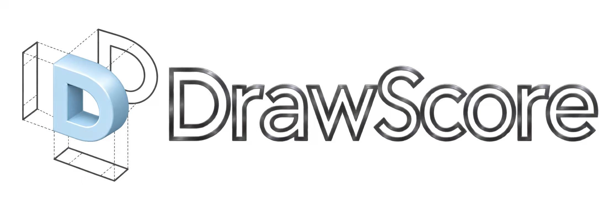
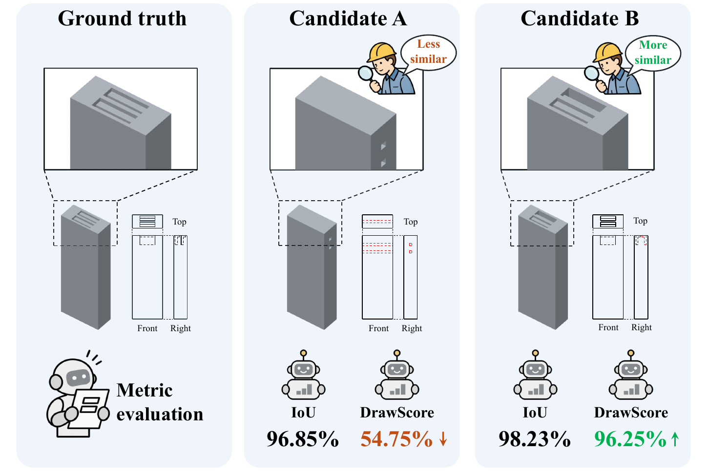

Official implementation of our paper: [DrawScore: Evaluating Generated CAD Models against Engineering Drawings](https://arxiv.org/abs/2611.24681).

[简体中文](README.md) · **English**

We introduce **DrawScore**, a metric for evaluating generated CAD parts through their orthographic engineering views.

Volume and surface metrics can give little weight to a misplaced hole or a slot cut into the wrong face because the error affects a small fraction of the part’s volume or surface area. In the figure below, candidate A puts both slots on the right face even though they belong on top. An engineer can spot the error at a glance in the orthographic views, yet volumetric IoU reaches **96.85%**. DrawScore’s **54.75%** better reflects the mismatch visible in the drawings.

<p align="center">
  
</p>

## Quick start

Install from the repository with **Python 3.12**. DrawScore runs on CPU using OpenCascade (via build123d) and Open3D.

```bash
git clone https://github.com/UESTC-Simon/DrawScore.git
cd DrawScore
python3.12 -m venv .venv
source .venv/bin/activate
python -m pip install .
```

On Debian or Ubuntu, if Open3D reports a missing OpenGL or OpenMP library, install the system runtimes with `sudo apt-get install libgl1 libgomp1`.

Run the following with your own STEP files, reference first. Both must contain solids at the same physical scale. DrawScore aligns their poses by rotation and translation.

```bash
drawscore reference.step candidate.step
```

The command prints one score to ten decimal places. Higher values indicate closer drawing agreement. Use `python -m drawscore` with the same arguments to run it as a module. A failed comparison writes an error to standard error and exits with a nonzero status.

## How DrawScore works

1. **Align the solids.** DrawScore samples both surfaces, estimates initial poses from their principal axes, and computes the rotation and translation with multiscale point-to-plane ICP.
2. **Project the engineering views.** Hidden-line removal produces visible and hidden curves from both solids using the same cameras. Each of the front, top, and right views is sampled at eight nearby angles.
3. **Measure missing and extra lines.** Each point along a reference curve receives credit according to its distance from the nearest candidate curve of the same visibility. Reversing the comparison measures extra lines in the candidate. The Gaussian weighting gives almost no credit to lines far outside the tolerance. A misplaced slot therefore counts in proportion to the length of the affected outlines.
4. **Keep the lowest view score.** Within each view, DrawScore averages precision and recall over the eight angles and takes their harmonic mean. Taking the minimum across views keeps a poor match in the right view visible in the final score even when the front and top views agree.

### Tolerance and timeout

The default tolerance is `0.005` times the reference bounding-box diagonal. For a 100 mm diagonal, the Gaussian distance scale is 0.5 mm. At that distance, a curve sample still receives about 61% credit. A smaller tolerance makes the comparison stricter, uses more curve samples, and narrows the range of viewing angles. Valid tolerance values lie strictly between 0 and 1.

The default deadline is 60 seconds. This command allows three minutes for a complex pair.

```bash
drawscore reference.step candidate.step --tolerance 0.005 --timeout 180
```

## Python API

```python
from drawscore import score_drawscore

if __name__ == "__main__":
    score = score_drawscore("reference.step", "candidate.step", tolerance=0.005)
    print(f"{score:.10f}")
```

Keep the main guard in scripts. Scoring starts a worker process so that the timeout can interrupt geometry operations. The Python API accepts the same `timeout` in seconds as the CLI.

## Development

Use [uv](https://docs.astral.sh/uv/) to install the locked development environment and run the checks.

```bash
uv sync --locked
uv run pytest
uv run ruff check .
uv run black --check .
uv run pyright
```

## License and attribution

DrawScore is released under the [Apache License 2.0](LICENSE). Its rigid alignment and surface sampling routines include code adapted from [CADGenBench](https://github.com/huggingface/cadgenbench). The [NOTICE](NOTICE) records the upstream revision and adaptations.
