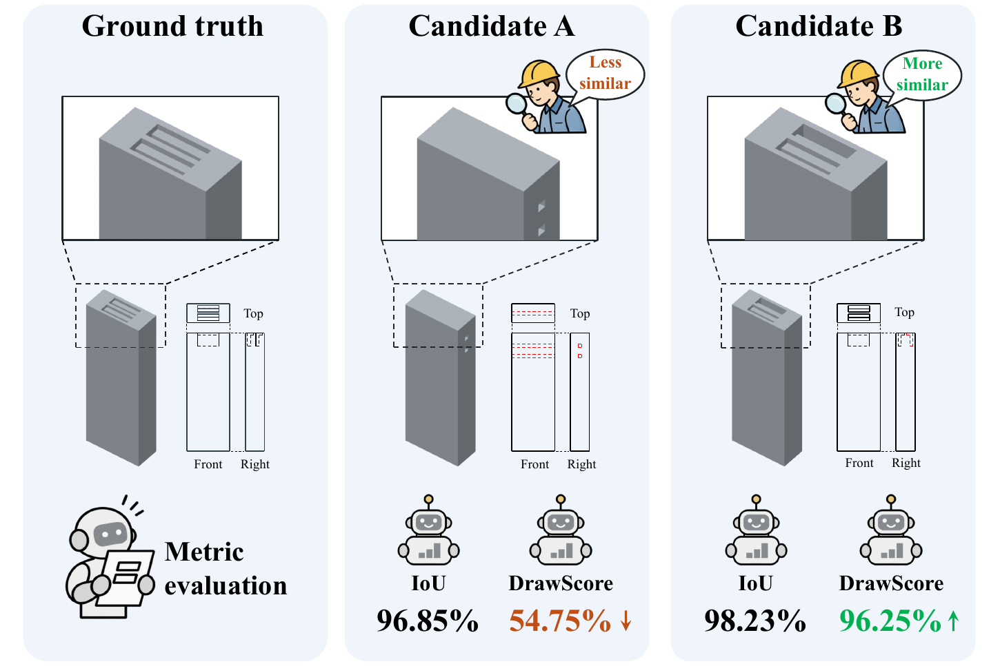

Official implementation of our paper: [DrawScore: Evaluating Generated CAD Models against Engineering Drawings](https://arxiv.org/abs/2611.24681).

# 用工程三视图评估生成的 CAD 模型

**简体中文** · [English](README.en.md)

我们推出 **DrawScore**：一种用工程三视图评估 CAD 生成结果的指标。

传统的体积和表面指标容易低估孔位偏移、槽开错面这类影响制造的错误，因为受影响的体积或表面积往往很小。如图，候选 A 把本该开在顶面的两道槽都开到了右侧面。工程师一看三视图就能发现这处错位，体积 IoU 却高达 **96.85%**，而 DrawScore 给出的 **54.75%** 更贴近看图时的直观判断。

<p align="center">
  
</p>

## 快速开始

在 Bash 中用 **Python 3.12** 安装 DrawScore。评分在 CPU 上运行，Open3D 负责对齐零件，OpenCascade 负责生成投影视图。

```bash
git clone https://github.com/UESTC-Simon/DrawScore.git
cd DrawScore
python3.12 -m venv .venv
source .venv/bin/activate
python -m pip install .
```

在 Debian 或 Ubuntu 上，如果导入 Open3D 时提示缺少 OpenGL 或 OpenMP 运行库，可运行 `sudo apt-get install libgl1 libgomp1`。

把下面的文件名换成自己的 STEP 文件，参考零件在前，待评估零件在后。两个文件都要包含实体，并采用相同的物理尺度。配准会旋转和平移零件，保留原始尺寸。

```bash
drawscore reference.step candidate.step
```

终端会显示一个 0 到 1 之间的分数。两个零件的三视图越相似，得分就越高。也可以用 `python -m drawscore` 加相同参数运行。评分失败时，程序将原因写入标准错误，并以非零状态码退出。

## 评分原理

1. **对齐零件。** 在两个实体的表面采样，用主成分分析估计初始姿态，再用多尺度点到平面 ICP 求出候选零件的旋转和平移。
2. **生成三视图。** 两个零件共用一组相机。在主视、俯视和右视三个标准方向附近各取八个角度，分别提取每个角度下的可见线和隐藏线。
3. **沿线比对。** 沿参考图的曲线按弧长采样。对每个采样点，在候选图里找最近的同类线条，可见线找可见线，隐藏线找隐藏线。两者越远，高斯函数给出的匹配分越低。从参考图出发统计召回率，漏掉的线会拉低分数。反过来统计精确率，多出的线也会扣分。
4. **合并分数。** 在每个视图内，先对八个角度的精确率和召回率分别取平均，再求两者的调和平均。三个视图中，哪一个得分最低，哪一个就决定零件的最终得分。

### 容差与超时

`--tolerance` 用参考零件包围盒对角线的长度设定容差，取值在 0 和 1 之间（不含端点）。默认值为 `0.005`，因此对角线长 100 mm 的零件对应 0.5 mm 的高斯距离尺度。一个采样点如果距最近的同类线条恰好 0.5 mm，匹配权重约为 **0.61**。调小容差后，同样的偏移会扣更多分，曲线采样也会更密，视角采样范围会收窄。

默认超时为 60 秒。复杂模型可以延长到 180 秒。

```bash
drawscore reference.step candidate.step --tolerance 0.005 --timeout 180
```

## Python 接口

```python
from drawscore import score_drawscore

if __name__ == "__main__":
    score = score_drawscore("reference.step", "candidate.step", tolerance=0.005)
    print(f"{score:.10f}")
```

在脚本中请保留 `if __name__ == "__main__":`。评分在独立进程中执行，以便在超时时终止几何运算。可以通过 `timeout` 指定秒数。

## 开发与测试

使用 uv 安装锁定版本的开发依赖并运行检查。

```bash
uv sync --locked
uv run pytest
uv run ruff check .
uv run black --check .
uv run pyright
```

## 许可证与致谢

DrawScore 采用 [Apache License 2.0](LICENSE)。刚体配准和表面采样的部分代码改编自 [CADGenBench](https://github.com/huggingface/cadgenbench)，对应的上游版本和改编说明见 [NOTICE](NOTICE)。
