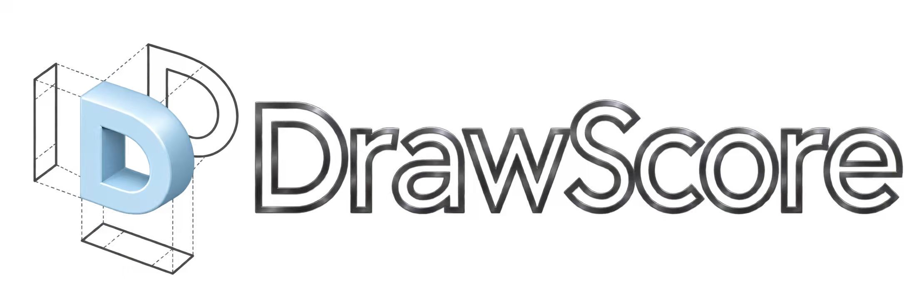

# DrawScore

<p align="center">
  
</p>

DrawScore compares two STEP models using their orthographic engineering drawings.
It rigidly aligns the candidate to the reference, projects visible and hidden curves,
and returns one similarity score between **0 and 1**. Higher is better.

## Installation

Use **Python 3.12**. No C++ compiler, external benchmark checkout, or GPU is required.
The geometry dependencies include OpenCascade (through build123d) and Open3D.

```bash
git clone https://github.com/UESTC-Simon/DrawScore.git
cd DrawScore
python3.12 -m venv .venv
source .venv/bin/activate
python -m pip install .
```

On Linux, Open3D requires the system OpenGL runtime. If it is missing, install it
with `sudo apt-get install libgl1 libgomp1` on Debian or Ubuntu.

## Usage

```bash
drawscore /path/to/reference.step /path/to/candidate.step --tolerance 0.005
```

Standard output contains only the score, for example:

```text
0.9731250000
```

The equivalent module entry point is:

```bash
python -m drawscore reference.step candidate.step --tolerance 0.005
```

`--tolerance` is a **dimensionless fraction of the reference model's bounding-box
diagonal**, not a distance in millimetres. It sets the Gaussian curve-distance
scale `sigma = tolerance × diagonal` and the local angular integration radius.
For example, a tolerance of `0.005` with a reference diagonal of 100 mm gives a
Gaussian distance scale of 0.5 mm. It is a soft scale rather than a hard matching
cutoff. The value must be finite and strictly between 0 and 1; the default is `0.005`.
Smaller values are stricter and require more curve samples.

Both STEP files must contain solid geometry and use the same physical scale.
Alignment applies rotation and translation; it does not rescale the candidate.
Registration uses sampled surfaces, so alignment of a rotated copy can be approximate.

Scoring has a 60-second deadline. Increase it for more complex models:

```bash
drawscore reference.step candidate.step --tolerance 0.005 --timeout 180
```

Missing files, invalid geometry, registration failures, and timeouts produce an
error on standard error and a nonzero exit code.

## Python API

```python
from drawscore import score_drawscore

if __name__ == "__main__":
    score = score_drawscore(
        "reference.step", "candidate.step", tolerance=0.005, timeout=60.0
    )
    print(f"{score:.10f}")
```

Use the `__main__` guard when calling from a script: scoring runs in a separate
process so the deadline can terminate geometry operations.

## How the score is computed

1. Sample the solid surfaces and align the candidate using PCA pose candidates
   and multiscale point-to-plane ICP.
2. Project the aligned pair with shared front, top, and right cameras at eight
   symmetric angular offsets around each standard view.
3. Union curves by visibility and integrate the Gaussian distance coverage in
   both directions. Visible curves match visible curves; hidden curves match
   hidden curves. Curve samples are weighted by arc length.
4. Average precision and recall over the angular samples, compute their harmonic
   mean for each view, and return the **minimum** of the three view scores.

The repository contains the standalone DrawScore implementation and its tests.

## Development

[uv](https://docs.astral.sh/uv/) can install the locked runtime and development tools:

```bash
uv sync --locked
uv run pytest
uv run ruff check .
uv run black --check .
uv run pyright
```

## License and attribution

Released under the [Apache License 2.0](LICENSE). Rigid alignment and surface
sampling include adapted code from [CADGenBench](https://github.com/huggingface/cadgenbench).
See [NOTICE](NOTICE) for the upstream revision and adaptation details.
